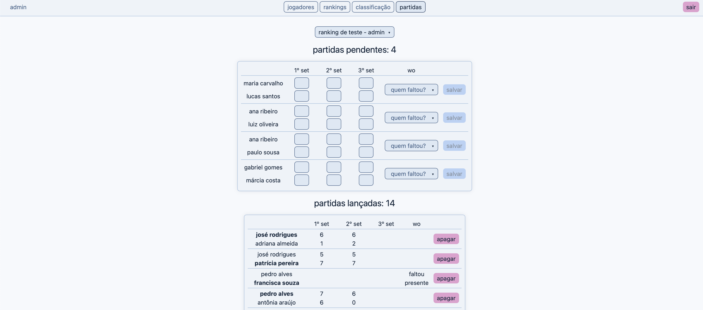
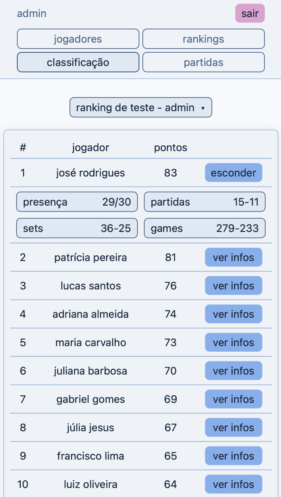

# tennis ladder

tennis ladder rankings: every round pairs each active player with 2 nearby opponents, points add up forever





## stack

- **backend**: python, flask, flask-login, sqlalchemy, sqlite; pytest for tests
- **frontend**: vue 3 (script setup), vite, vue-router, vue-i18n; vitest for tests
- **infra**: docker, nginx (reverse proxy, rate limiting, static file serving)

## run (local)

```bash
cd backend && uv sync
cd frontend && npm install
```

```bash
cd backend && uv run python run.py   # http://localhost:5000
cd frontend && npm run dev           # http://localhost:5173
```

open http://localhost:5173

## run (docker)

```bash
docker compose up --build # always rebuilds it
docker compose down -v    # stops and deletes volumes
```

open http://localhost

## config

if no `.env` is configured, the app uses insecure public default values.
to set your own values, copy `.env.example` to `.env` and edit it:

```bash
cp .env.example .env
```

`.env` is read by docker compose only, a local run reads env vars from the shell.
`DEFAULT_ADMIN_PASS` and `DEFAULT_ADMIN_SEED_RANKING` are only used on the startup that creates the default admin.
an unset or empty var falls back to its default below.

## env vars

| var                          | default             | used in                                                    |
|------------------------------|---------------------|------------------------------------------------------------|
| `SECRET_KEY`                 | `dev-default-value` | flask session signing                                      |
| `SESSION_COOKIE_SECURE`      | `0`                 | `1` sends the session cookie only over https               |
| `DEFAULT_ADMIN_NAME`         | `admin`             | default admin username, the only one with the reset button |
| `DEFAULT_ADMIN_PASS`         | `admin pass`        | default admin password (set on first run)                  |
| `DEFAULT_ADMIN_SEED_RANKING` | `1`                 | `0` skips the default admin's sample ranking               |
| `FLASK_HOST`                 | `127.0.0.1`         | flask bind address; set to `0.0.0.0` in docker via compose |
| `FLASK_DEBUG`                | `1`                 | reloader and debugger; set to `0` in docker via compose    |
| `DATABASE_URL`               | `backend/app.db`    | sqlalchemy db url; docker points it to the `/data` volume  |

## admins

only admins log in, new ones are created by hand and start with no data.

```bash
cd backend && uv run create_admin.py <username> <password>                     # local
docker compose exec flask-backend python create_admin.py <username> <password> # docker
```

## pages

| page         | who    | can do                                                               |
|--------------|--------|----------------------------------------------------------------------|
| `/standings` | public | view any ranking's standings                                         |
| `/matches`   | public | view any ranking's current round; its owner enters or clears results |
| `/rankings`  | admin  | create rankings, start and close rounds, add and remove players      |
| `/players`   | admin  | create and rename players; reset (default admin only)                |

reset button: wipes the default admin's data, then creates the sample ranking again.

## test

```bash
cd backend && uv run pytest
cd frontend && npm test
```

## codebase guides

- [RULES.md](RULES.md): ranking, round, scoring and pairing rules
- [BACK_READ.md](BACK_READ.md), [FRONT_READ.md](FRONT_READ.md) and [INFRA_READ.md](INFRA_READ.md): beginner guides
- [TODO.md](TODO.md): known improvements and future work
